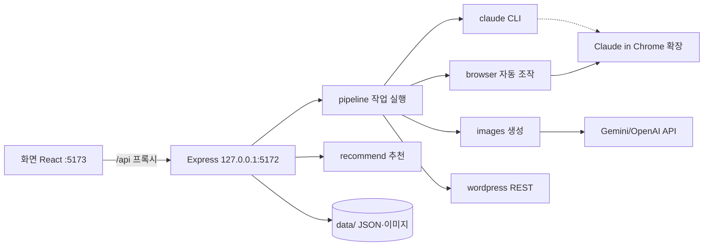

# 아키텍처

## 구성

## 핵심 설계
- **로컬 전용 API**: Host와 Origin이 모두 localhost/127.0.0.1/[::1]이어야 한다(아니면 403). 다른 사이트가 브라우저로 호출(CSRF)하거나 DNS 리바인딩하는 것을 막는다. 서버는 `127.0.0.1`에만 listen한다. JSON 본문 한도 2MB(이미지 업로드는 별도 20MB).
- **작업 = 파일 하나**: 글 작업은 `data/jobs/<id>.json`. 읽기-수정-쓰기를 id별 큐로 직렬화해(`updateJob`) 로그와 상태가 서로 덮어쓰지 않게 한다.
- **비동기 작업 모델**: 라우트가 검사 후 상태를 먼저 "진행 중"으로 바꾸고(`markBusy`) 202를 돌려주면, 백그라운드 함수(`runDraft`, `runImages`, `runPost`, `startEdit`)가 실행한다. 화면은 작업을 주기적으로 읽어 진행을 따라간다. 같은 작업은 한 번에 하나(`running` 집합), 예외로 이미지 한 장씩은 동시에 가능.
- **크롬 직렬화**: Claude in Chrome 작업(블로그 작성, Gemini·ChatGPT 이미지)은 같은 크롬을 쓰므로 `enqueueBrowser` 큐로 하나씩 한다.
- **중지**: 작업마다 `AbortController`를 `AsyncLocalStorage`로 전달해, 그 안에서 부르는 `runClaude` 등이 바로 멈춘다.
- **서버 재시작 복구**: 시작할 때 진행 중이던 작업·추천을 실패/초안 상태로 되돌린다(`recoverStuckJobs`, `recoverRecommendations`), 90일 지난 사용량 기록 정리.
- **공용 코드**(`shared/`)를 서버와 화면이 함께 쓴다: 타입, 글자수·키워드·말투 판정, 붙여넣기 HTML, 상태 필터.

## 레이어
| 레이어 | 위치 | 모듈 |
|---|---|---|
| 프롬프트 | `server/writer.ts` 등 | [[_system/modules/server-core]] |
| 서버 | `server/**` | [[_system/modules/server-pipeline]], [[_system/modules/server-routes]] |
| 공용 | `shared/**` | [[_system/modules/shared]] |
| 화면 | `src/**` | [[_system/modules/web-app]] |
