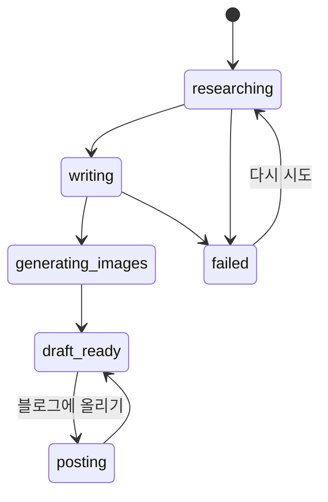

# 작업 (Job)

## 의미
주제 하나를 받아 글을 만들고 블로그에 올리기까지의 모든 기록을 담은 단위다. 화면의 "내 글" 한 줄이 작업 하나이고, 서버는 `data/jobs/<id>.json` 파일 하나로 저장한다. 글 자체는 [[writing/entities/글]], 올린 결과는 블로그별 상태(`blogs`)로 들어 있다.

## 속성
| 속성 | 타입 | 의미 | 화면 표시 |
|---|---|---|---|
| `id` | uuid | 작업 식별자, 파일 이름 | 주소창 |
| `topic` | string(2~300자) | 글 주제 | 목록 제목 |
| `links` | string[] (최대 20) | 사용자가 준 참고 링크 | 폼 |
| `status` | researching/writing/generating_images/draft_ready/posting/failed | 진행 단계 | 상태 배지 |
| `imageOptions` | ImageOptions | 만들 때 고른 이미지 옵션 → [[image/overview]] | |
| `writingOptions` | [[writing/entities/글쓰기 옵션]] | 고른 분량·말투·형식 (없으면 예전 작업) | |
| `post` | [[writing/entities/글]] | 쓴 글 (초안 전에는 없음) | 초안 화면 |
| `sources` / `notes` | Source[] / string | 조사 출처와 노트 | 참고 자료 |
| `rulesSnapshot` | string | 작업 시작 때의 글쓰기 규칙 사본 → [[writing/business-rules/BR-WRT-009 글쓰기 규칙 문서와 작업별 사본]] | |
| `editProposal` | [[writing/entities/수정 제안]] | 프롬프트로 고친 결과 | 비교 화면 |
| `blogs` / `postingTo` | 블로그별 상태 | 올린 결과 → [[publishing/overview]] | |
| `logs` / `error` | 진행 로그 / 오류 | | 로그 창 |

## 상태 / 수명주기

- 진행 중 상태(`BUSY_STATUSES`: researching, writing, generating_images, posting)에서는 글을 직접 고칠 수 없고 삭제도 거절된다.
- 서버가 죽으면서 진행 중으로 남은 작업은 시작할 때 초안이 있으면 `draft_ready`, 없으면 `failed`로 바꾸고 "서버가 재시작되어 작업이 중단되었습니다."를 남긴다(`recoverStuckJobs`).
- 예전 글(상태가 posted/scheduled/published)은 읽을 때 블로그별 상태로 옮긴다(`migrateJob`). → [[publishing/overview]]

## 관련 규칙
[[writing/business-rules/BR-WRT-009 글쓰기 규칙 문서와 작업별 사본]], [[writing/business-rules/BR-WRT-011 프롬프트로 글 고치기]]
