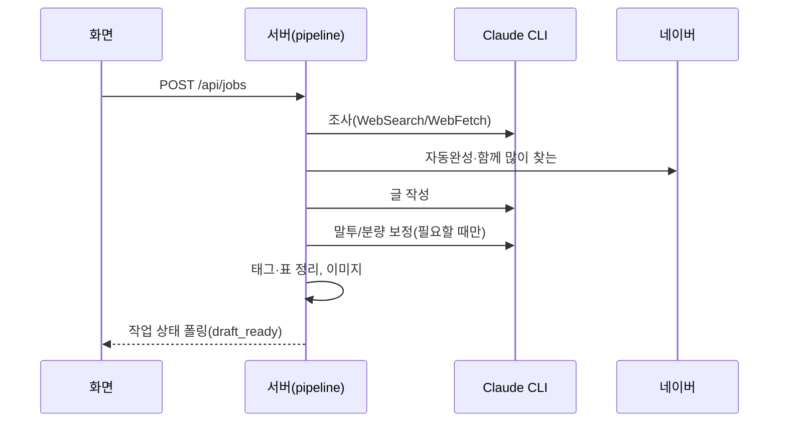

# 초안 작성

## 목적
주제 하나로 자료 조사 → 글 작성 → 검사·보정 → (이미지) → 초안(`draft_ready`)까지 자동으로 만든다.

## 단계
| # | 단계 | 위치 | 관련 규칙 |
|---|---|---|---|
| 1 | 입력 검사(주제 2~300자, 링크 ≤20개 http(s), 분량·말투), 작업 저장, 마지막 옵션을 설정에 기억 | `routes/jobs.ts` | [[writing/business-rules/BR-WRT-001 분량 목표와 상한]] |
| 2 | `researching`: 글쓰기 규칙을 읽어 `rulesSnapshot` 저장 | `pipeline.ts` | [[writing/business-rules/BR-WRT-009 글쓰기 규칙 문서와 작업별 사본]] |
| 3 | 웹 조사 → 검색 질문·키워드·노트·출처 | `research.ts` | [[writing/business-rules/BR-WRT-010 자료 조사]] |
| 4 | 네이버 자동완성·함께 많이 찾는 수집 | `naver.ts` | [[writing/business-rules/BR-WRT-007 태그 수와 출처 확인]] |
| 5 | `writing`: 글 작성(effort high, 15분) | `writer.ts:writePost` | [[writing/business-rules/BR-WRT-013 글 구조와 문단 형식]], [[writing/business-rules/BR-WRT-005 제목 후보와 후킹 기법]] |
| 6 | 말투 검사·재작성 1번 | `enforceTone` | [[writing/business-rules/BR-WRT-002 말투와 문장 끝 검사]] |
| 7 | 분량 초과 시 줄이기 최대 2번 | `enforceLength` | [[writing/business-rules/BR-WRT-001 분량 목표와 상한]] |
| 8 | 태그 출처 확인, 불완전 표·날짜 표시줄 제거, 이미지 개수 맞추기 | `writePost` | [[writing/business-rules/BR-WRT-006 확인된 사실만 쓰기]] |
| 9 | `generating_images`: 본문 이미지 만들기(썸네일은 제목 확정 후 버튼으로) | `images/` | [[image/overview]] |
| 10 | `draft_ready` | | |

## 시퀀스

## 실패 / 예외 경로
| 상황 | 결과 | 사용자에게 보이는 것 |
|---|---|---|
| 조사·작성 실패/시간 초과 | 작업 `failed` + `error` | 오류 문구와 "다시 시도" |
| 사용자가 중지 | 작업 중지(`CancelledError`) | "사용자가 작업을 중지했습니다" |
| 서버 재시작 | 초안 있으면 `draft_ready`, 없으면 `failed` | "서버가 재시작되어 작업이 중단되었습니다" |
| 이미지 실패 | 글은 유지, 이미지에 오류 기록 | 이미지별 오류 → [[image/overview]] |
| 분량·말투가 끝내 어긋남 | 그대로 두고 로그 | 로그 안내 |

## 관련 엔티티
[[writing/entities/작업]], [[writing/entities/글]], [[writing/entities/글쓰기 옵션]]
